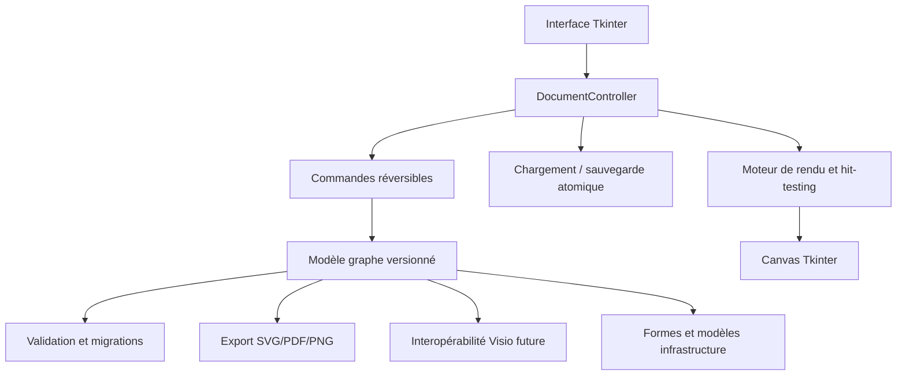

# OpenVisio — Audit architectural et plan de rationalisation

**Date :** 18 octobre 2026  
**Auteur :** Abdelhalim Talbi  
**Périmètre audité :** branche `develop/openvisio-python-v42`, application Python/Tkinter, modèle JSON, export SVG, formes, propriétés, tests, chaîne Windows.  
**Statut :** revue statique du code et de la configuration CI. Les succès GitHub Actions démontrent la compilation et le smoke test de démarrage, **pas** la qualification complète d'un poste utilisateur.

## 1. Synthèse exécutive

Le projet dispose d'une base fonctionnelle : dessin d'équipements, liaisons, métadonnées, sérialisation atomique, export SVG et fabrication Windows PyInstaller/Inno Setup. Le code natif Python reste volontairement indépendant de l'ancienne implémentation JS/.NET. Le moteur n'a pas encore la maturité d'un éditeur Visio : l'interface, les interactions, l'état et la persistance sont encore trop étroitement couplés. La parité fonctionnelle avec l'ancien produit n'est pas acquise.

**Décision : stabiliser le cœur et l'expérience d'édition avant d'étendre la bibliothèque de formes ou d'introduire l'import VSDX.**

## 2. Défauts et dette technique constatés

| ID | Gravité | Élément | Observation | Correctif |
| --- | --- | --- | --- | --- |
| A01 | Critique | app.py | Nouveau/Ouvrir ne demandent pas confirmation pour les modifications non sauvegardées | état dirty, dialogue Enregistrer/Abandonner/Annuler, fermeture contrôlée |
| A02 | Critique | modèle | Validation historique des liaisons sans unicité d'identifiant, coordonnées NaN/Inf acceptées | validateur strict séparé (première correction réalisée) |
| A03 | Haute | éditeur | Absence d'historique undo/redo pour créer, déplacer, relier, supprimer | commandes réversibles et transactions de glisser |
| A04 | Haute | app.py | Contrôleur Tkinter monolithique, mutations directes des dictionnaires | DocumentController et services de commande |
| A05 | Haute | SVG | Taille fixe 1600×1000, clipping et coordonnées négatives possibles | calcul bounding box, marges, viewBox dynamique |
| A06 | Haute | build | Vérification de démarrage du portable seulement, pas de test automatisé installer ni E2E document | VM Windows vierge, installation silencieuse, scénario E2E et désinstallation |
| A07 | Haute | JSON | Pas de schéma versionné, pas de migration ni de compatibilité garantie | format versionné et migrations |
| A08 | Moyenne | interactions | Déplacement redessine tout le canevas à chaque mouvement ; sélection des liaisons calculée linéairement | mise à jour incrémentale, index spatial après mesure |
| A09 | Moyenne | ergonomie | Menu de formes rudimentaire, aucune grille, zoom, panoramique ou raccourcis Undo | palette, outils d'alignement, zoom |
| A10 | Moyenne | packaging | Versions/noms figés dans plusieurs scripts ; ZIP peu complet côté historiques et rapports | source unique de version, manifestes et rapports par release |
| A11 | Moyenne | docs | Word/PDF brefs, sans schémas ni tutoriels illustrés | documentation générée depuis sources versionnées, vraies captures ou rapport d'absence |
| A12 | Moyenne | édition | Sélection du lien et du nœud dépend du clic, pas de tests automatisés GUI | tests d'interaction Windows, scénarios reproductibles |

### 2.1 Points positifs à préserver

- **Python standard + Tkinter** : exécution native sans dépendance Java/JavaScript sur le PC cible.
- **Écriture atomique** par fichier temporaire puis `os.replace` : bon point de départ pour la sécurité des sauvegardes.
- **Séparation initiale** de `model.py`, `export.py`, `shapes.py`, `links.py`, `properties.py`.
- **CI Windows** avec compilation PyInstaller, installateur Inno Setup, tests et artefact cumulatif.
- **Distinction explicite** entre compilation réussie, smoke test et qualification fonctionnelle.

## 3. Architecture cible



Arborescence **cible progressive**, sans casser l'installation actuelle :

```text
python/
  openvisio/
    app.py                # composition et lancement
    core/
      document.py         # graphe, identifiants, version du format
      commands.py         # undo/redo, transactions
      validation.py       # validation pure
      persistence.py      # JSON atomique, migrations
    ui/
      main_window.py      # menus, toolbar, panneaux
      canvas_view.py      # rendu, zoom, hit-testing
      dialogs.py          # formulaires de propriétés
    features/
      shapes.py           # catalogue de symboles
      connections.py      # SAN, réseau, protocole
      templates.py        # topologies prêtes à l'emploi
    io/
      svg.py              # export vectoriel
      visio.py            # interopérabilité future
  tests/
    unit/
    integration/
    gui/
  scripts/
  installer/
  docs/
  binary/                 # sorties Windows construites, pas sources
```

**Migration incrémentale :** conserver temporairement des modules de compatibilité `openvisio.model`, `openvisio.export` et l'entrée `openvisio.app`. Ne pas déplacer les modules en bloc sans tests de régression.

## 4. Priorisation des versions suivantes

| Version proposée | Priorité | Périmètre | Critères de sortie |
| --- | --- | --- | --- |
| V42.1 — Stabilisation | P0 | schéma JSON versionné, sauvegarde/fermeture sûre, validations, tests de round-trip | zéro perte de modifications non confirmée, fichiers invalides refusés sans détruire le document ouvert |
| V42.2 — Édition fiable | P0 | undo/redo, sélection multi-objets, copier/coller, suppression contrôlée | historique réversible sur création, déplacement, liaison, propriétés |
| V42.3 — Ergonomie | P1 | zoom/pan, grille, snap, alignement, raccourcis, barre d'outils | navigation fluide et cohérente sur diagrammes moyens |
| V42.4 — Export | P1 | SVG auto-dimensionné, PDF/PNG, impression, titres/légendes | aucun clipping des objets hors origine et validation visuelle |
| V42.5 — Infrastructure | P1 | palette hiérarchique, propriétés SAN, ports, fabric A/B, modèles d'architecture | modèles SAN et stockage sauvegardables, éditables et exportables |
| V42.6 — Interopérabilité | P1/P2 | import/export VSDX par étapes, compatibilité des formes et connecteurs | matrice explicite des fonctionnalités conservées/perdues |
| V42.7 — Performance | P2 | rendu incrémental, index spatial, benchmarks 100/1000/5000 objets | métriques et budgets de latence documentés |
| V42.8 — Livraison | P0 transversal | Windows propre, signature optionnelle, rapport CI, SBOM, SHA256, docs enrichies | portable et setup installés/testés hors sources, ZIP complet |

Ces numéros sont **une feuille de route**, pas des versions déjà publiées.

## 5. Stratégie de tests

1. **Unitaires** : schéma JSON, collisions d'ID, NaN/Inf, ports, protocoles, SVG XML valide, validation IP.
2. **Intégration** : sauvegarder → rouvrir → comparer, export SVG → parse XML, récupération d'erreurs et permissions.
3. **GUI** : créer, sélectionner, déplacer, renommer, relier, annuler, sauvegarder, fermer/réouvrir.
4. **Packaging Windows** : exécutable isolé, installateur silencieux, raccourcis, association .ovjson, désinstallation.
5. **Non-régression** : fixtures de diagrammes, golden SVG avec tolérance visuelle, compatibilité format antérieur.
6. **Performance** : temps d'ouverture, de déplacement, d'export, mémoire et taille de ZIP sur scénarios 100/1000/5000 objets.

## 6. Critères de livraison systématiques

- Python uniquement pour la nouvelle application ; aucune dépendance aux sources sur le PC cible.
- Portable EXE et installateur EXE x64 ; génération par un seul `Build-Windows.cmd`.
- ZIP cumulatif organisé, incluant sources, tests, binaires, documents Word/PDF, rapports et manifestes SHA256.
- Captures **réelles** uniquement ; absence explicitement déclarée lorsqu'aucun test graphique n'a été réalisé.
- CI verte et publication de l'artefact ; la qualification sur machine indépendante est tracée séparément.
- Travail en branche dédiée et PR avant intégration à `main`.

## 7. Décisions immédiates

**Réalisé dans cette passe :** extraction de la validation stricte vers `validation.py`, tests de collisions d'identifiants et coordonnées non finies.  
**À implémenter ensuite :** protection contre les pertes de données, état dirty, commandes réversibles et export SVG dimensionné automatiquement.

**Auteur : Abdelhalim Talbi**
